# HotelPro — Database Architecture & ER Diagram Specification

## 1. Overview & Data Model Evolution

The data tier of **HotelPro** is implemented using **MongoDB 7.0+** and modeled via **Mongoose ODM 8.x**. It provides transactional data integrity, fine-grained validation, relational consistency via references, and optimized compound indexing.

### Flaws in the Initial Legacy ER Diagram
The baseline reference ER diagram contained critical flaws that would prevent real-world execution:
1. **Unlawful Cardholder Data Storage**: Stored `cardDetails` (`cardNumber`, `cyvcode`, `expmonthyear`, `cardholdername`) in plain document fields, directly violating **PCI-DSS Requirement 3.2** (prohibiting storage of sensitive authentication data / CVV after authorization).
2. **Redundant Security Fields**: Persisted `c_password` (confirm password) in the `user` collection. Confirm password is a transient transport-validation artifact, never a persistent attribute.
3. **Impaired Room Availability Model**: Placed `fromdate`, `todate`, `booking_id`, and `count` attributes directly on the `room` document. A physical hotel room exists independently of dates; conflating the physical room with a reservation interval makes multi-day and recurring reservations impossible.
4. **Lack of Property Isolation**: Directly linked `user` to `room` with a generic `has` relationship, omitting hotel ownership, property partitioning, and staff governance.
5. **Missing Relational Entities**: Lacked entities for `Hotel`, `RoomType` (category), `BookingRoom` (multi-room reservations), `Payment`, `Refund`, `StaffAssignment`, `HousekeepingTask`, `ServiceRequest`, `Review`, `Notification`, and `AuditLog`.

---

## 2. Complete Entity-Relationship (ER) Diagram

The diagram below represents the corrected logical and relational database architecture of HotelPro.

```mermaid
erDiagram
    USER ||--o{ BOOKING : places
    USER ||--o{ REVIEW : writes
    USER ||--o{ NOTIFICATION : receives
    USER ||--o{ SERVICE_REQUEST : creates
    USER ||--o{ AUDIT_LOG : triggers
    USER ||--o{ STAFF_ASSIGNMENT : assigned_to

    HOTEL ||--|{ ROOM_TYPE : offers
    HOTEL ||--|{ ROOM : contains
    HOTEL ||--o{ BOOKING : hosts
    HOTEL ||--o{ STAFF_ASSIGNMENT : employs
    HOTEL ||--o{ HOUSEKEEPING_TASK : manages

    ROOM_TYPE ||--|{ ROOM : categorizes
    ROOM_TYPE ||--o{ BOOKING_ROOM : reserves

    ROOM ||--o{ BOOKING_ROOM : assigned_in
    ROOM ||--o{ HOUSEKEEPING_TASK : cleaned_by

    BOOKING ||--|{ BOOKING_ROOM : includes
    BOOKING ||--o{ PAYMENT : funded_by
    BOOKING ||--o{ REVIEW : reviewed_in
    BOOKING ||--o{ SERVICE_REQUEST : logs

    PAYMENT ||--o{ REFUND : initiates

    USER {
        ObjectId _id PK
        string name
        string email UK
        string passwordHash
        string phone
        string role "guest | staff | admin"
        string accountStatus "active | suspended | pending"
        date emailVerifiedAt
        string resetPasswordToken
        date resetPasswordExpires
        date createdAt
        date updatedAt
    }

    HOTEL {
        ObjectId _id PK
        string name
        string slug UK
        string description
        string address
        string city
        string state
        string country
        string postalCode
        object contactDetails
        string[] amenities
        string[] photos
        string status "active | inactive | maintenance"
        date createdAt
        date updatedAt
    }

    ROOM_TYPE {
        ObjectId _id PK
        ObjectId hotelId FK
        string name "Deluxe Ocean Suite, etc."
        string description
        number basePrice
        number maxOccupancy
        number bedCount
        string bedType "King | Queen | Twin"
        number roomSizeSqFt
        string[] amenities
        string[] photos
        boolean isActive
        date createdAt
        date updatedAt
    }

    ROOM {
        ObjectId _id PK
        ObjectId hotelId FK
        ObjectId roomTypeId FK
        string roomNumber "Composite UK with hotelId"
        number floor
        string operationalStatus "available | occupied | maintenance | out_of_order"
        date createdAt
        date updatedAt
    }

    BOOKING {
        ObjectId _id PK
        string bookingReference UK
        ObjectId userId FK
        ObjectId hotelId FK
        date checkInDate
        date checkOutDate
        number guestCount
        string bookingStatus "pending_payment | confirmed | checked_in | checked_out | cancelled | expired"
        number subtotal
        number taxes
        number fees
        number totalAmount
        string currency "INR"
        object guestDetails
        object cancellationDetails
        date holdExpiresAt
        date createdAt
        date updatedAt
    }

    BOOKING_ROOM {
        ObjectId _id PK
        ObjectId bookingId FK
        ObjectId roomTypeId FK
        ObjectId roomId FK "Nullable until physical room allocation"
        number pricePerNight
        number nightsCount
        number totalPrice
        date createdAt
        date updatedAt
    }

    PAYMENT {
        ObjectId _id PK
        ObjectId bookingId FK
        ObjectId userId FK
        string provider "razorpay"
        string providerOrderId UK
        string providerPaymentId UK
        string providerSignature
        number amount
        string currency "INR"
        string paymentStatus "created | authorized | captured | failed | refunded"
        date verifiedAt
        object rawResponseMetadata
        date createdAt
        date updatedAt
    }

    REFUND {
        ObjectId _id PK
        ObjectId paymentId FK
        ObjectId bookingId FK
        string providerRefundId UK
        number amount
        string reason
        string refundStatus "pending | processed | failed"
        date processedAt
        date createdAt
        date updatedAt
    }

    REVIEW {
        ObjectId _id PK
        ObjectId bookingId FK "1:1 with Booking"
        ObjectId userId FK
        ObjectId hotelId FK
        ObjectId roomTypeId FK
        number rating "1 to 5"
        string title
        string comment
        string status "published | hidden | flagged"
        date createdAt
        date updatedAt
    }

    NOTIFICATION {
        ObjectId _id PK
        ObjectId userId FK
        string title
        string message
        string type "booking | payment | system | housekeeping"
        boolean isRead
        object metadata
        date createdAt
    }

    STAFF_ASSIGNMENT {
        ObjectId _id PK
        ObjectId userId FK
        ObjectId hotelId FK
        string department "front_desk | housekeeping | maintenance | management"
        boolean isActive
        date assignedAt
        date createdAt
        date updatedAt
    }

    HOUSEKEEPING_TASK {
        ObjectId _id PK
        ObjectId hotelId FK
        ObjectId roomId FK
        ObjectId assignedToStaffId FK "Nullable"
        string taskType "turnover | daily_cleaning | deep_cleaning | inspection"
        string priority "low | medium | high | urgent"
        string status "pending | in_progress | completed | verified"
        string remarks
        date scheduledDate
        date completedAt
        date createdAt
        date updatedAt
    }

    SERVICE_REQUEST {
        ObjectId _id PK
        ObjectId bookingId FK
        ObjectId hotelId FK
        ObjectId roomId FK
        ObjectId guestId FK
        ObjectId handledByStaffId FK "Nullable"
        string requestType "room_service | extra_linen | maintenance | luggage"
        string description
        string status "open | in_progress | resolved | cancelled"
        date createdAt
        date updatedAt
    }

    AUDIT_LOG {
        ObjectId _id PK
        ObjectId actorId FK
        string actorRole "guest | staff | admin | system"
        string action "BOOKING_CREATED | PAYMENT_VERIFIED | STATUS_CHANGED | etc."
        string resourceType "Booking | Payment | Room | User"
        ObjectId resourceId
        string ipAddress
        string userAgent
        object changes
        date timestamp
    }
```

---

## 3. Detailed Data Dictionaries & Schemas

### 3.1 `users` Collection
Stores authentication credentials, security attributes, and access tiers.
- `_id` (`ObjectId`): Primary key.
- `name` (`String`, required, trimmed, min 2, max 100): Full name of the user.
- `email` (`String`, required, unique, lowercase, indexed): Verified email address.
- `passwordHash` (`String`, required): Bcrypt hashed password (12 salt rounds).
- `phone` (`String`, required, trimmed): Contact phone number.
- `role` (`String`, enum: `['guest', 'staff', 'admin']`, default: `'guest'`): Access role.
- `accountStatus` (`String`, enum: `['active', 'suspended', 'pending']`, default: `'active'`).
- `emailVerifiedAt` (`Date`, default: `null`): Timestamp of email verification.
- `resetPasswordToken` (`String`, default: `null`, sparse index): Cryptographic SHA-256 token hash.
- `resetPasswordExpires` (`Date`, default: `null`): Expiration timestamp for reset token.
- `timestamps`: `createdAt`, `updatedAt`.

**Security Constraint:** Registration endpoints enforce `role = 'guest'` automatically. The `admin` role can never be self-assigned during registration.

### 3.2 `hotels` Collection
Stores property identity, location, contacts, and configuration.
- `_id` (`ObjectId`): Primary key.
- `name` (`String`, required, trimmed, max 150): Hotel name.
- `slug` (`String`, required, unique): SEO-friendly slug.
- `description` (`String`, required): Detailed property narrative.
- `address`, `city`, `state`, `country`, `postalCode` (`String`, required): Physical address.
- `contactDetails` (`Object`): `{ phone: String, email: String, emergencyContact: String }`.
- `amenities` (`[String]`): List of hotel-wide amenities (e.g., "Infinity Pool", "Spa", "Free WiFi").
- `photos` (`[String]`): Array of secure image URLs hosted on cloud storage.
- `status` (`String`, enum: `['active', 'inactive', 'maintenance']`, default: `'active'`).
- `timestamps`: `createdAt`, `updatedAt`.

### 3.3 `room_types` Collection
Represents sellable room categories (e.g., "Executive King Suite").
- `_id` (`ObjectId`): Primary key.
- `hotelId` (`ObjectId`, ref: `'Hotel'`, required, indexed): Belonging property.
- `name` (`String`, required): Category name.
- `description` (`String`): Detailed room features.
- `basePrice` (`Number`, required, min 0): Baseline night rate before seasonal rules and tax.
- `maxOccupancy` (`Number`, required, min 1): Maximum allowed guests.
- `bedCount` (`Number`, required, min 1): Number of beds.
- `bedType` (`String`, enum: `['Single', 'Double', 'Queen', 'King', 'Twin']`).
- `roomSizeSqFt` (`Number`): Physical dimensions.
- `amenities` (`[String]`): Room-level amenities (e.g., "Ocean View", "Balcony", "Espresso Machine").
- `photos` (`[String]`): Room category imagery.
- `isActive` (`Boolean`, default: `true`).

### 3.4 `rooms` Collection
Represents physical rooms in inventory.
- `_id` (`ObjectId`): Primary key.
- `hotelId` (`ObjectId`, ref: `'Hotel'`, required, indexed): Owning hotel.
- `roomTypeId` (`ObjectId`, ref: `'RoomType'`, required, indexed): Physical specification category.
- `roomNumber` (`String`, required): Distinct identifier within the hotel (e.g., "101", "Penthouse-A").
- `floor` (`Number`, required): Floor number.
- `operationalStatus` (`String`, enum: `['available', 'occupied', 'maintenance', 'out_of_order']`, default: `'available'`).
- **Compound Index:** `{ hotelId: 1, roomNumber: 1 }` with `unique: true`.

### 3.5 `bookings` Collection
Records guest reservations, billing calculations, and reservation lifecycle states.
- `_id` (`ObjectId`): Primary key.
- `bookingReference` (`String`, required, unique, uppercase): Human-readable alphanumeric code (e.g., `HP-2026-98721`).
- `userId` (`ObjectId`, ref: `'User'`, required, indexed): Reserving guest.
- `hotelId` (`ObjectId`, ref: `'Hotel'`, required, indexed): Property booked.
- `checkInDate` (`Date`, required, indexed): Inclusive start date of stay.
- `checkOutDate` (`Date`, required, indexed): Exclusive end date of stay.
- `guestCount` (`Number`, required, min 1): Number of guests.
- `bookingStatus` (`String`, enum: `['pending_payment', 'confirmed', 'checked_in', 'checked_out', 'cancelled', 'expired']`, default: `'pending_payment'`, indexed).
- `subtotal` (`Number`, required, min 0): Raw room charge.
- `taxes` (`Number`, required, min 0): Applied taxes (e.g., GST 18%).
- `fees` (`Number`, required, min 0): Service or cleaning fees.
- `totalAmount` (`Number`, required, min 0): Final gross total payable.
- `currency` (`String`, default: `'INR'`): Three-letter ISO code.
- `guestDetails` (`Object`): `{ fullName: String, email: String, phone: String, specialRequests: String }`.
- `cancellationDetails` (`Object`, default: `null`): `{ cancelledAt: Date, cancelledBy: ObjectId, reason: String, refundEligible: Boolean }`.
- `holdExpiresAt` (`Date`, indexed): Automatic expiration timestamp for unconfirmed temporary holds (15 minutes).

### 3.6 `booking_rooms` Collection
Connects individual physical rooms or allocated room types to a master booking.
- `_id` (`ObjectId`): Primary key.
- `bookingId` (`ObjectId`, ref: `'Booking'`, required, indexed).
- `roomTypeId` (`ObjectId`, ref: `'RoomType'`, required).
- `roomId` (`ObjectId`, ref: `'Room'`, default: `null`): Assigned physical room; can be dynamically allocated at check-in or confirmed during hold.
- `pricePerNight` (`Number`, required): Fixed booked night rate.
- `nightsCount` (`Number`, required): Total nights.
- `totalPrice` (`Number`, required): `pricePerNight * nightsCount`.

### 3.7 `payments` Collection
Stores transaction verification records.
- `_id` (`ObjectId`): Primary key.
- `bookingId` (`ObjectId`, ref: `'Booking'`, required, indexed).
- `userId` (`ObjectId`, ref: `'User'`, required, indexed).
- `provider` (`String`, default: `'razorpay'`).
- `providerOrderId` (`String`, required, unique, indexed): Razorpay `order_id`.
- `providerPaymentId` (`String`, unique, sparse, indexed): Razorpay `pay_id`.
- `providerSignature` (`String`): Cryptographic HMAC-SHA256 signature.
- `amount` (`Number`, required): Amount in currency units (or smallest currency sub-unit like paise).
- `currency` (`String`, default: `'INR'`).
- `paymentStatus` (`String`, enum: `['created', 'authorized', 'captured', 'failed', 'refunded']`, default: `'created'`).
- `verifiedAt` (`Date`, default: `null`): Server-side verification timestamp.
- `rawResponseMetadata` (`Object`): Structured non-sensitive gateway response payload.

### 3.8 `refunds` Collection
Tracks automated and manual refund operations.
- `_id` (`ObjectId`): Primary key.
- `paymentId` (`ObjectId`, ref: `'Payment'`, required, indexed).
- `bookingId` (`ObjectId`, ref: `'Booking'`, required, indexed).
- `providerRefundId` (`String`, required, unique): Gateway refund transaction ID (`rfnd_xxx`).
- `amount` (`Number`, required): Refunded amount.
- `reason` (`String`): Business reason for refund.
- `refundStatus` (`String`, enum: `['pending', 'processed', 'failed']`, default: `'pending'`).
- `processedAt` (`Date`): Timestamp of gateway settlement.

### 3.9 `reviews` Collection
Stores authenticated guest reviews and ratings.
- `_id` (`ObjectId`): Primary key.
- `bookingId` (`ObjectId`, ref: `'Booking'`, required, unique): One review per completed booking.
- `userId` (`ObjectId`, ref: `'User'`, required, indexed).
- `hotelId` (`ObjectId`, ref: `'Hotel'`, required, indexed).
- `roomTypeId` (`ObjectId`, ref: `'RoomType'`, required).
- `rating` (`Number`, required, min 1, max 5).
- `title` (`String`, required, max 100).
- `comment` (`String`, required, max 2000).
- `status` (`String`, enum: `['published', 'hidden', 'flagged']`, default: `'published'`).

### 3.10 `notifications` Collection
In-app and system communication records for users.
- `_id` (`ObjectId`): Primary key.
- `userId` (`ObjectId`, ref: `'User'`, required, indexed).
- `title` (`String`, required).
- `message` (`String`, required).
- `type` (`String`, enum: `['booking', 'payment', 'system', 'housekeeping']`, default: `'system'`).
- `isRead` (`Boolean`, default: `false`, indexed).
- `metadata` (`Object`): Link references (`bookingId`, etc.).

### 3.11 `staff_assignments` Collection
Associates staff members with specific hotels and operational roles.
- `_id` (`ObjectId`): Primary key.
- `userId` (`ObjectId`, ref: `'User'`, required, indexed).
- `hotelId` (`ObjectId`, ref: `'Hotel'`, required, indexed).
- `department` (`String`, enum: `['front_desk', 'housekeeping', 'maintenance', 'management']`, required).
- `isActive` (`Boolean`, default: `true`).
- **Compound Index:** `{ userId: 1, hotelId: 1 }` with `unique: true`.

### 3.12 `housekeeping_tasks` Collection
Operational task management for hotel cleaning and maintenance.
- `_id` (`ObjectId`): Primary key.
- `hotelId` (`ObjectId`, ref: `'Hotel'`, required, indexed).
- `roomId` (`ObjectId`, ref: `'Room'`, required, indexed).
- `assignedToStaffId` (`ObjectId`, ref: `'User'`, default: `null`, indexed).
- `taskType` (`String`, enum: `['turnover', 'daily_cleaning', 'deep_cleaning', 'inspection']`, required).
- `priority` (`String`, enum: `['low', 'medium', 'high', 'urgent']`, default: `'medium'`).
- `status` (`String`, enum: `['pending', 'in_progress', 'completed', 'verified']`, default: `'pending'`, indexed).
- `remarks` (`String`).
- `scheduledDate` (`Date`, required).
- `completedAt` (`Date`, default: `null`).

### 3.13 `service_requests` Collection
Guest service and assistance tracking.
- `_id` (`ObjectId`): Primary key.
- `bookingId` (`ObjectId`, ref: `'Booking'`, required, indexed).
- `hotelId` (`ObjectId`, ref: `'Hotel'`, required, indexed).
- `roomId` (`ObjectId`, ref: `'Room'`, required).
- `guestId` (`ObjectId`, ref: `'User'`, required).
- `handledByStaffId` (`ObjectId`, ref: `'User'`, default: `null`).
- `requestType` (`String`, enum: `['room_service', 'extra_linen', 'maintenance', 'luggage']`, required).
- `description` (`String`, required).
- `status` (`String`, enum: `['open', 'in_progress', 'resolved', 'cancelled']`, default: `'open'`, indexed).

### 3.14 `audit_logs` Collection
Immutable compliance and security trail.
- `_id` (`ObjectId`): Primary key.
- `actorId` (`ObjectId`, ref: `'User'`, default: `null`, indexed).
- `actorRole` (`String`, required).
- `action` (`String`, required, indexed).
- `resourceType` (`String`, required, indexed).
- `resourceId` (`ObjectId`, indexed).
- `ipAddress` (`String`).
- `userAgent` (`String`).
- `changes` (`Object`): Before and after state representation.
- `timestamp` (`Date`, default: `Date.now`, indexed).

---

## 4. Availability Engine Mathematical Model & Query Strategy

Double bookings are strictly eliminated through interval collision detection combined with multi-document ACID transactions.

### 4.1 Date Range Collision Formula
Two date intervals $[CheckIn_A, CheckOut_A)$ and $[CheckIn_B, CheckOut_B)$ overlap if and only if:
$$\text{Overlap} \iff (CheckIn_A < CheckOut_B) \land (CheckOut_A > CheckIn_B)$$

### 4.2 Availability Calculation Pipeline
To find available rooms for a `roomTypeId` within interval $[T_{in}, T_{out})$:
1. Total physical room count for category:
   $$N_{total} = \text{count}(\text{Room.find}(\{ hotelId, roomTypeId, operationalStatus: 'available' \}))$$
2. Confirmed & Active Hold reservations occupying the category:
   $$N_{reserved} = \text{count}(\text{BookingRoom.aggregate}(...))$$ where parent `Booking` satisfies:
   - `hotelId` matches target hotel.
   - `bookingStatus` in `['confirmed', 'checked_in']` OR (`bookingStatus == 'pending_payment'` AND `holdExpiresAt > now()`).
   - `checkInDate < T_{out}` AND `checkOutDate > T_{in}`.
3. Available Capacity:
   $$N_{available} = N_{total} - N_{reserved}$$
   If $N_{available} \ge \text{requestedRooms}$, reservation hold proceeds.

---

## 5. Indexes, Uniqueness Constraints & Archival Policy

### 5.1 Primary Database Indexes
- `users`: `{ email: 1 }` (unique).
- `hotels`: `{ slug: 1 }` (unique).
- `rooms`: `{ hotelId: 1, roomNumber: 1 }` (unique compound index).
- `bookings`: `{ bookingReference: 1 }` (unique); `{ hotelId: 1, checkInDate: 1, checkOutDate: 1, bookingStatus: 1 }` (compound availability index); `{ holdExpiresAt: 1 }` (TTL/sparse index for hold sweeps).
- `payments`: `{ providerOrderId: 1 }` (unique); `{ providerPaymentId: 1 }` (unique sparse); `{ bookingId: 1 }`.
- `reviews`: `{ bookingId: 1 }` (unique); `{ hotelId: 1, rating: -1 }`.
- `staff_assignments`: `{ userId: 1, hotelId: 1 }` (unique compound).
- `audit_logs`: `{ timestamp: -1 }`; `{ resourceType: 1, resourceId: 1 }`.

### 5.2 Deletion & Archival Policies
- **Soft Deletion (`isActive = false` / `status = 'archived'`)**: Applied to `hotels`, `room_types`, `rooms`, and `users`. Hard deletion of historical entities is strictly prohibited to preserve financial and audit integrity.
- **Audit Log Retention**: Audit logs are strictly append-only. No `delete` or `update` operations are exposed in API or service layers.
