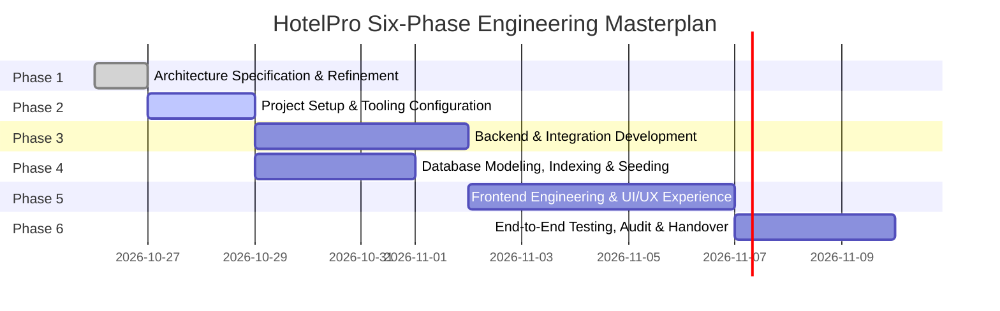

# HotelPro — Implementation Roadmap & Execution Blueprint

## 1. Roadmap Architecture & Phase Progression

This roadmap translates the system architecture into a phased, disciplined engineering sequence. Each phase defines clear entry prerequisites, core deliverable milestones, dependency chains, risk controls, and validation exit criteria.

---

## 2. Phase-by-Phase Execution Details

### Phase 1: Project Architecture & Technical Refinement (Current Phase)
- **Objective:** Establish the comprehensive architectural blueprint, resolve flaws in reference diagrams, and produce authoritative specification documents.
- **Key Deliverables:**
  - `docs/architecture/SYSTEM_ARCHITECTURE.md`
  - `docs/architecture/ER_DIAGRAM.md`
  - `docs/architecture/USER_FLOWS.md`
  - `docs/architecture/RBAC_MATRIX.md`
  - `docs/architecture/API_ARCHITECTURE.md`
  - `docs/architecture/ARCHITECTURE_DECISIONS.md`
  - `docs/architecture/SECURITY_ARCHITECTURE.md`
  - `docs/architecture/IMPLEMENTATION_ROADMAP.md`
- **Exit Criteria:** All architectural documents created, internally consistent, cross-referenced, and validated against requirements.

---

### Phase 2: Project Setup and Tooling Configuration
- **Prerequisites:** Phase 1 architecture approved.
- **Key Deliverables:**
  - Initialize repository layout: separate `/server` and `/client` root directories.
  - Setup Node.js backend environment: `server/package.json` with dependencies (`express`, `mongoose`, `jsonwebtoken`, `bcryptjs`, `dotenv`, `cors`, `helmet`, `express-rate-limit`, `express-mongo-sanitize`, `express-validator`, `multer`, `nodemailer`, `razorpay`).
  - Setup React frontend environment: `client/package.json` with Vite, React 18, React Router v6, Axios, Bootstrap 5, Lucide React icons.
  - Setup environment variable templates: `server/.env.example` and `client/.env.example`.
  - Configure ESLint, Prettier, and Git hygiene.
- **Exit Criteria:** Both `npm run dev` in `client` and `npm run dev` in `server` start cleanly without warnings or errors.

---

### Phase 3: Backend & Integration Development
- **Prerequisites:** Phase 2 configuration complete.
- **Key Deliverables:**
  - Express application initialization (`server/src/app.js` and `server/src/server.js`) with centralized middleware pipeline (Helmet, CORS, Rate Limiter, Sanitizer, Error Handler).
  - Authentication engine: JWT signing, refresh token rotation, bcrypt password hashing.
  - RBAC & tenant isolation middleware: `rbacMiddleware` and `tenantGuard`.
  - Domain services:
    - `AvailabilityService`: Dynamic date-range overlap calculation and temporary hold manager.
    - `PricingEngine`: Dynamic rate calculations, weekend pricing, taxes, and service fees.
    - `BookingService`: ACID transactional booking orchestration.
    - `PaymentService`: Razorpay order creation, HMAC signature verification, and webhook handler.
    - `HousekeepingService`: Task dispatch and operational tracking.
    - `NotificationService`: Transactional email templates with Nodemailer.
    - `AuditLogService`: Immutable audit event logging.
  - REST API Controllers and Routes adhering strictly to `/api/v1` API architecture.
- **Exit Criteria:** All API endpoints respond with standardized JSON envelopes; unit and integration tests for auth and booking pass.

---

### Phase 4: Database Development & Seeding
- **Prerequisites:** Phase 2 setup and Phase 3 schema definitions.
- **Key Deliverables:**
  - Define all 14 Mongoose schemas with data types, validators, lifecycle hooks, and JSON transform filters (`passwordHash` hidden).
  - Setup MongoDB connection with replica set support and retry logic.
  - Implement compound indexes:
    - `{ hotelId: 1, roomNumber: 1 }` (unique)
    - `{ hotelId: 1, checkInDate: 1, checkOutDate: 1, bookingStatus: 1 }`
    - `{ providerOrderId: 1 }` (unique)
    - `{ bookingId: 1 }` (unique for reviews)
  - Comprehensive Database Seeder (`server/src/seeds/seed.js`):
    - Default Super Admin user.
    - Flagship Luxury Hotel profile with amenities and images.
    - 4 distinct Room Types (Deluxe Room, Executive Suite, Ocean Penthouse, Family Villa).
    - 20 physical room units mapped across floors.
    - Seed Staff accounts with property assignments.
- **Exit Criteria:** Running `npm run db:seed` provisions an operational, fully indexed database without errors.

---

### Phase 5: Frontend Development & UI/UX Experience
- **Prerequisites:** Phase 3 backend and Phase 4 database running.
- **Key Deliverables:**
  - Core Design Tokens: Luxury hotel styling with modern typography, custom CSS variables (`--hp-gold`, `--hp-navy`, `--hp-card-bg`), and responsive Bootstrap 5 integration.
  - Reusable UI Components: Navigation bar, footer, date-range picker, room card, price badge, booking summary drawer, modal dialogues, toast notifications, skeleton loaders.
  - Public Website Views:
    - Home Page: Premium hero section, hotel highlights, guest reviews, featured room categories.
    - Room Discovery: Search filters (dates, guests, price, amenities), live availability badges.
    - Room Detail View: Gallery carousel, amenity pills, bed configurations, dynamic price breakdown.
    - Static Pages: About, Contact, FAQ, Terms, Privacy.
  - Guest Experience:
    - Login & Registration modals/pages with inline validation.
    - Booking Checkout: Guest details form, reservation timer countdown (15-min hold), Razorpay checkout modal integration.
    - Guest Dashboard: Active reservations, booking history, PDF invoice download, cancellation modal, review submission.
  - Staff Operations Portal:
    - Front Desk: Reservation search, instant check-in room assignment, check-out processing.
    - Housekeeping: Task list, room status toggles (`maintenance` -> `available`).
  - Admin Governance Console:
    - KPI Dashboard: Real-time occupancy, revenue, ADR, RevPAR.
    - Hotel & Room Management: Add/edit properties, room categories, physical rooms.
    - Booking Oversight: Global reservations table with search and cancellation controls.
    - Audit Trail: Immutable security event log viewer.
- **Exit Criteria:** Flawless cross-browser responsiveness (mobile, tablet, desktop); zero console errors; smooth booking-to-payment transitions.

---

### Phase 6: Project Execution, Validation & Automated Testing
- **Prerequisites:** Phase 3, 4, 5 functional.
- **Key Deliverables:**
  - Automated Browser Testing via Playwright:
    - Flow 1: Visitor search -> room selection -> guest login -> checkout hold -> simulated Razorpay payment -> booking confirmation.
    - Flow 2: Staff login -> lookup booking -> check-in guest -> verify room status changes to occupied.
    - Flow 3: Guest cancellation within 48h -> verify status changes to cancelled and inventory hold is freed.
    - Flow 4: Security test: verify public user cannot access `/api/v1/admin/*` or `/api/v1/staff/*` endpoints (assert 401/403).
  - Concurrency Validation: Execute parallel booking test with 5 concurrent requests attempting to book 1 remaining room unit; assert exactly 1 reservation succeeds and 4 receive 409 Conflict without double-booking.
  - Security Audit: Verify no card details or CVVs exist in any database collection; verify password hashes cannot be read via API.
- **Exit Criteria:** 100% test pass rate across Playwright test suite; full end-to-end verification report signed off.
