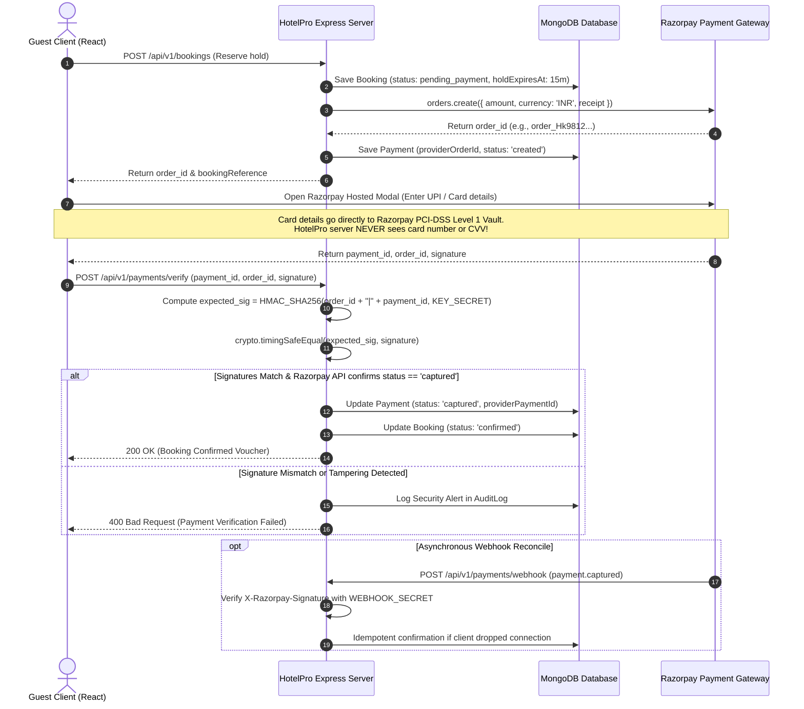

# HotelPro — Security Architecture & Threat Mitigation Blueprint

## 1. Security Philosophy & Defense-in-Depth

**HotelPro** employs a **Defense-in-Depth** security architecture across all layers of the stack. Trust boundaries are established at the network perimeter, application entry points, domain service layers, data access layers, and third-party integrations.

```
[ Client / Untrusted Perimeter ]
             │
   TLS 1.3 / HTTPS Only
             ▼
[ Perimeter Defense: Helmet, Strict CORS, Rate Limiting ]
             │
[ Transport Sanitization: JSON Body Limiter, NoSQL Sanitizer ]
             │
[ Authentication Layer: Cryptographic JWT Verification ]
             │
[ Authorization Layer: RBAC Guard & Property Multi-Tenant Isolation ]
             │
[ Domain Validation: Schema Validation via express-validator ]
             │
[ Domain Service Layer: ACID Transactions & Business Invariants ]
             │
[ Data Access Layer: Least-Privilege Mongo User & Encrypted Storage ]
```

---

## 2. Threat Modeling & STRIDE Matrix

The application's threat landscape was assessed using the **STRIDE** methodology. The table below outlines identified threats and architectural mitigations:

| STRIDE Category | Specific Threat Scenario | Risk Level | Architectural Mitigation Strategy |
| :--- | :--- | :---: | :--- |
| **Spoofing** | Attacker impersonates guest or staff by forging JWT tokens or guessing credentials. | **High** | Cryptographically signed HS256/RS256 JWT tokens with 15-minute expiration; bcrypt (cost factor 12) password hashing; strict rate-limiting on `/auth/login` (5 failures/15 mins); account lockout mechanisms. |
| **Tampering** | Attacker intercepts checkout response to submit a fake payment success receipt or modify booking prices. | **Critical** | Server-side price calculation authoritative over database; zero client price trust; payment verified via HMAC-SHA256 signature verification comparing `order_id + "|" + payment_id` with gateway secret using constant-time equality. |
| **Repudiation** | Staff member cancels booking or updates room status without attribution. | **Medium** | Immutable append-only `audit_logs` collection capturing `actorId`, `ipAddress`, `userAgent`, timestamp, and before/after delta for all administrative, financial, and operational mutations. |
| **Information Disclosure** | Sensitive payment card details or user credentials leaked in logs or API responses. | **Critical** | Zero-card-data architecture (PCI-DSS SAQ-A); password hash excluded from Mongoose `toJSON` transforms; logging pipelines scrub authorization headers, tokens, and PII; production error responses strip stack traces. |
| **Denial of Service** | Malicious actor floods availability search or booking endpoints to exhaust server resources. | **High** | Tiered rate limiting (`express-rate-limit`); JSON request body cap (10kb); optimized compound MongoDB indexes for sub-10ms query execution; database connection pooling. |
| **Elevation of Privilege** | Guest registers and alters payload to assign `role: 'admin'`, gaining root control over system. | **Critical** | Public registration endpoint discards incoming `role` fields and strictly forces `role = 'guest'`; admin routes enforce `rbacMiddleware` and reject non-admin tokens with `403 Forbidden`. |

---

## 3. Authentication & Session Lifecycle

### 3.1 Password Security & Hashing
- Algorithm: `bcryptjs` utilizing 12 salt rounds (computationally expensive against GPU brute-forcing).
- Minimum Password Requirements: At least 8 characters, containing at least one uppercase letter, one lowercase letter, one numeric digit, and one special symbol.
- Never store plaintext passwords or confirmation passwords (`confirmPassword` is validated exclusively in memory at transport validation time).

### 3.2 Token Architecture & Invalidation
- **Access Token:**
  - Standard: JWT signed with `JWT_ACCESS_SECRET`.
  - Expiry: 15 minutes.
  - Payload: `{ userId: string, role: string, email: string }`.
  - Storage: In-memory React state (Zustand/Context), preventing persistent XSS theft.
- **Refresh Token:**
  - Standard: 64-character cryptographically random hex string.
  - Expiry: 7 days.
  - Storage: Stored exclusively inside an `HttpOnly`, `Secure` (HTTPS only), `SameSite=Strict` cookie. Inaccessible to client JavaScript.
  - Rotation: Each refresh exchange invalidates the old refresh token and issues a new pair.

### 3.3 Password Reset Workflow
1. User submits email to `POST /api/v1/auth/forgot-password`.
2. Server generates an unguessable 32-byte cryptographic token: `crypto.randomBytes(32).toString('hex')`.
3. Server computes SHA-256 hash of the token and stores it in `user.resetPasswordToken` alongside a 1-hour expiration timestamp.
4. Server sends the unhashed token via email in a secure one-time link.
5. User submits new password with the token to `POST /api/v1/auth/reset-password`.
6. Server hashes the incoming token, finds matching user, updates `passwordHash`, and nullifies `resetPasswordToken`.

---

## 4. Payment Security & PCI-DSS Scope Reduction

HotelPro achieves the highest standard of payment security by implementing a **Zero-Card-Data Retention** architecture.



### 4.1 Payment Verification Rules
1. **Never Trust Client Status:** A message from the client saying "payment succeeded" is completely ignored.
2. **Cryptographic HMAC Signature Verification:** The backend recomputes the HMAC-SHA256 hash using the server-side `RAZORPAY_KEY_SECRET`. Signatures are compared using constant-time comparison (`crypto.timingSafeEqual`) to prevent timing side-channel attacks.
3. **Gateway State Confirmation:** The backend calls Razorpay's REST API (`razorpay.payments.fetch(paymentId)`) to verify that the amount and currency match the booking record exactly.
4. **Idempotency Guarantee:** Payment and webhook endpoints maintain unique compound indexes on `providerOrderId` and `providerPaymentId`. Duplicate webhook deliveries produce a safe `200 OK` acknowledgment without duplicating booking confirmations or receipts.

---

## 5. Input Validation, Sanitization & Injection Defense

### 5.1 NoSQL Injection Mitigation
MongoDB operators (such as `$gt`, `$ne`, `$where`) in untrusted JSON payloads could alter query logic if not sanitized.
- Mitigation: Application uses `express-mongo-sanitize` to strip all `$` and `.` characters from incoming `req.body`, `req.query`, and `req.params`.
- Query Parameterization: All queries utilize explicit Mongoose schema casting rather than raw objects:
  ```javascript
  // Protected against NoSQL injection
  const booking = await Booking.findOne({
    _id: String(req.params.id),
    userId: req.user._id
  });
  ```

### 5.2 Cross-Site Scripting (XSS) & Content Security Policy (CSP)
- `Helmet` configured with strict CSP directives:
  - Disallows inline script execution unless specifically hashed.
  - Restricts connection endpoints (`connect-src`) to application APIs and Razorpay checkout scripts (`https://api.razorpay.com`, `https://checkout.razorpay.com`).
- Output Encoding: React natively escapes HTML entities within JSX expressions, rendering stored XSS inert.

### 5.3 Cross-Origin Resource Sharing (CORS)
- Strict origin whitelisting:
  ```javascript
  const corsOptions = {
    origin: process.env.CLIENT_ORIGIN || 'http://localhost:3000',
    credentials: true,
    methods: ['GET', 'POST', 'PUT', 'PATCH', 'DELETE'],
    allowedHeaders: ['Content-Type', 'Authorization', 'X-Requested-With']
  };
  app.use(cors(corsOptions));
  ```

---

## 6. Secure Media Upload Pipeline

Hotel and room imagery upload introduces potential arbitrary file execution or server-side memory exhaustion risks.
- **In-Memory Storage Buffer:** Multer is configured to use `memoryStorage()`, preventing temporary files from being written to the server's local disk.
- **Strict MIME-Type & Magic Byte Validation:** Uploads are restricted strictly to `image/jpeg`, `image/png`, and `image/webp`. File extensions and MIME headers are verified against magic byte signatures.
- **File Size Cap:** Capped at 5 MB per image.
- **Direct Cloud Offloading:** Upload buffers are streamed directly to Cloudinary or AWS S3 using signed API keys. Server instances remain completely stateless.

---

## 7. Audit Logging & Security Event Monitoring

The `audit_logs` collection provides an immutable, append-only record of compliance-sensitive events:
- User authentication events (successful logins, consecutive failed attempts, password resets).
- Financial transactions (order creation, successful capture, refund initiations).
- Administrative modifications (room price updates, role reassignments, property status changes).
- Data access anomalies (attempted cross-tenant property access by staff).

Each log record captures:
- `timestamp`: UTC timestamp.
- `actorId`: Authenticated user ID (or `'SYSTEM'`).
- `actorRole`: Active role during invocation.
- `action`: Standardized enum (e.g., `PAYMENT_CAPTURED`, `BOOKING_CANCELLED`).
- `ipAddress`: Client IP address (retrieved via trusted proxy).
- `userAgent`: Client browser/device agent.
- `resourceType` & `resourceId`: Target entity reference.
- `changes`: JSON delta showing previous and updated state attributes.
