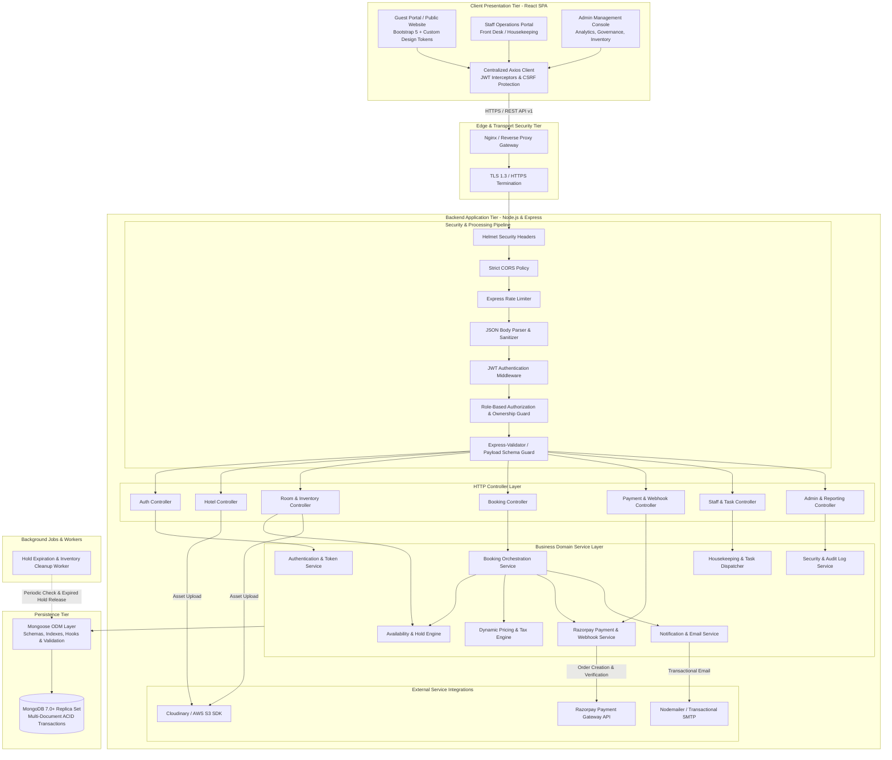

# HotelPro — System Architecture Specification

## 1. Executive Summary & Architectural Vision

**HotelPro** is an enterprise-grade, cloud-ready Hotel Booking and Management System built on the MERN stack (MongoDB, Express.js, React.js, Node.js). It delivers an end-to-end guest reservation experience, staff operational workflows (front desk, check-in/out, housekeeping, service dispatch), and administrative property governance.

This document establishes the **Single Source of Truth (SSOT)** for the architectural blueprint of HotelPro. It supersedes initial legacy reference diagrams, addressing identified architectural oversights, critical security liabilities, and scalability bottlenecks to deliver a modular monolithic architecture engineered for high concurrency, zero double-bookings, strict PCI-DSS compliance boundaries, and multi-property extensibility.

---

## 2. Evaluation of Initial Reference Architecture & Corrective Refinement

Initial reference diagrams provided during project inception contained fundamental architectural anti-patterns, security risks, and structural bottlenecks. The following table contrasts the baseline reference models with the refined architecture:

| Architectural Dimension | Initial Reference Diagram | Deficiencies & Risks | Refined Production Architecture |
| :--- | :--- | :--- | :--- |
| **System Layering** | Simple 3-box pipeline ("UI → Web Server → API Gateway → DB") | Conflated presentation, routing, business logic, and persistence. Ambiguous "API Gateway" in a monolithic app. | **Clean 6-Tier Architecture**: React UI → HTTPS/Security Middleware → Controllers → Business Service Layer → Mongoose ODM → MongoDB Database. |
| **Component Organization** | MVC with "MODAL" typos and `/db/Admin`, `/db/User` coupling | Directly coupled file system paths to database operations. Lack of service layer produced fat models/controllers. | **Modular Domain-Driven Monolith**: Clear separation of concern (`controllers/`, `services/`, `models/`, `validators/`, `integrations/`). |
| **Database Structure** | 3 collections (`user`, `room`, `booking`) | Incapable of managing hotels, room categories, physical inventory, multi-room bookings, transactions, or audit logs. | **14 Normalized Collections**: Full relational integrity via Mongoose references, composite uniqueness, and audit trails. |
| **Payment Security** | Raw `cardDetails` (`cardNumber`, `cyvcode`, `expmonthyear`) stored in DB | **Catastrophic PCI-DSS Violation**. Unencrypted card numbers and CVV storage expose platform to severe legal and security liability. | **Zero-Card-Data Architecture**: Offloaded to **Razorpay** hosted checkout. Backend only stores `providerOrderId`, `providerPaymentId`, and cryptographic HMAC signatures. |
| **Privilege Escalation** | Visitor signup flow directly transitions into `Admin` portal | Total breakdown of access control. Any malicious visitor could self-promote to administrator. | **Strict RBAC & Trust Boundary**: Public signup is strictly locked to `guest`. `staff` and `admin` roles provisioned exclusively via privileged seed/super-admin workflows. |
| **Inventory & Availability** | `room` entity holds `fromdate`, `todate`, `count`, `booking_id` | Cannot handle multi-day overlapping stays, seasonal pricing, or concurrent bookings across dates. | **Dynamic Date-Interval Availability Engine**: Atomic inventory holds, reservation interval collision detection, and multi-document ACID transactions. |

---

## 3. High-Level Logical System Architecture

The HotelPro backend implements a **Modular Monolith** designed for high cohesion and loose coupling. The frontend operates as a decoupled Single-Page Application (SPA) communicating exclusively via versioned REST APIs.



---

## 4. Architectural Layers & Responsibilities

### 4.1 Client Presentation Tier (React.js SPA)
- **Role:** Renders responsive, accessible, high-performance user interfaces for Guests, Staff, and Administrators.
- **Technology:** React 18, React Router v6, Bootstrap 5 foundation enhanced with custom luxury hotel design tokens (CSS variables), Axios, React Context / Zustand for lightweight reactive state.
- **Guiding Principles:**
  - Zero business rule authority: The UI never calculates pricing, confirms inventory availability, or declares payment authenticity.
  - Strict Token Security: JWT access tokens stored in memory / secure closures; refresh tokens stored in secure, `HttpOnly`, `SameSite=Strict` cookies.
  - Granular Error States: Graceful degradation with skeleton loaders, contextual form validation feedback, and centralized error modal dispatch.

### 4.2 Edge & Transport Security Tier
- **Role:** Enforces TLS encryption, connection throttling, cross-origin resource isolation, and header hardening.
- **Components:**
  - `Helmet`: Sets HTTP response headers (`X-Content-Type-Options`, `X-Frame-Options: DENY`, `Strict-Transport-Security`, Content Security Policy).
  - `CORS`: Whitelists permitted origins strictly (`http://localhost:3000` for local dev; verified production domains).
  - `express-rate-limit`: Protects sensitive routes (`/api/v1/auth/login`, `/api/v1/auth/register`, `/api/v1/payments/verify`) against brute-force attacks and credential stuffing.

### 4.3 Routing & Middleware Pipeline Tier
- **Role:** Directs HTTP requests through uniform pre-processing pipelines.
- **Pipeline Order:**
  1. Request Logging & Correlation ID injection (`requestId` trace).
  2. JSON parsing (`express.json({ limit: '10kb' })`) to prevent payload exhaustion attacks.
  3. NoSQL Injection & XSS sanitization.
  4. Authentication Guard: Decodes JWT from Authorization header or cookie, attaches authenticated user model to `req.user`.
  5. RBAC & Ownership Guard: Validates `req.user.role` against required permissions and checks property-level access isolation.
  6. Request Schema Validator: Enforces strict input validation rules using `express-validator` prior to controller invocation.

### 4.4 Controller Tier
- **Role:** Handles HTTP-specific request parsing, status codes, and response serialization.
- **Boundary Rule:** Controllers must remain "skinny". They must not contain SQL/Mongoose queries, pricing formulas, or external API calls directly.
- **Standardized Response Format:**
  ```json
  {
    "success": true,
    "statusCode": 200,
    "message": "Resource fetched successfully",
    "data": {},
    "meta": { "page": 1, "limit": 20, "total": 100 }
  }
  ```

### 4.5 Business Domain Service Tier
- **Role:** Encapsulates the core business rules and workflows of HotelPro.
- **Core Services:**
  - `AvailabilityService`: Implements reservation overlap calculations, date-interval queries, and temporary hold locking.
  - `PricingEngine`: Computes server-authoritative rates, weekend markups, seasonal pricing adjustments, local occupancy taxes, and cleaning/service fees.
  - `BookingService`: Orchestrates the booking lifecycle, state machine transitions, and inventory reservation.
  - `PaymentService`: Integrates with Razorpay SDK, generates orders, verifies cryptographic HMAC SHA256 signatures, and processes idempotency checks for webhooks.
  - `HousekeepingService`: Automatically generates cleaning tasks upon checkout and assigns operational workflows to hotel staff.
  - `AuditLogService`: Records immutable, append-only logs of critical security, financial, and administrative operations.

### 4.6 Mongoose Data Access Tier & Database Persistence
- **Role:** Manages schema definitions, data constraints, custom query helpers, pre-save sanitization hooks, and transactional consistency.
- **Database Engine:** MongoDB 7.0+ configured as a 3-node Replica Set (primary-secondary-arbiter or 3 data nodes) to enable **Multi-Document ACID Transactions** (`session.startTransaction()`).
- **Indexes:** Compound and sparse indexes tuned for query latency under sub-10ms for date-range overlap scans.

### 4.7 Integration & Asynchronous Task Tier
- **Payment Provider:** Razorpay API for checkout order generation and server-side signature verification.
- **Email Service:** Nodemailer over secure SMTP / SendGrid for transactional notifications (booking vouchers, password resets, check-in instructions).
- **Media Asset Storage:** Cloudinary or AWS S3 with signed upload URLs for high-resolution hotel and room imagery.
- **Background Timers/Crons:** Node-cron or lightweight scheduled jobs to monitor and purge expired temporary inventory holds (`HOLD_EXPIRY_MINUTES = 15`).

---

## 5. Technology Stack & Decision Matrix

| Layer / Concern | Chosen Technology | Rationale | Alternatives Evaluated |
| :--- | :--- | :--- | :--- |
| **Runtime Environment** | Node.js (LTS v20+) | Event-driven, asynchronous I/O ideal for concurrent web traffic and I/O-heavy integration tasks. | Python/Django, Go |
| **Web Framework** | Express.js 4.x | Mature, battle-tested, unopinionated routing framework with rich middleware ecosystem. | Fastify, NestJS |
| **Database** | MongoDB (v7.0+) | Document-oriented model mirrors rich hierarchical hotel/room/booking records; native multi-document ACID transactions. | PostgreSQL, MySQL |
| **Data Modeling** | Mongoose (v8.x) | Strong schema enforcement, virtual population, lifecycle hooks, and type validation over MongoDB. | Prisma, Native Mongo Driver |
| **Frontend Framework** | React.js (v18.x) with Vite | Component-driven architecture, fast declarative DOM rendering, large ecosystem, and rapid development. | Next.js, Vue.js |
| **UI Styling** | Bootstrap 5 + Custom CSS Tokens | Rapid responsive grid system combined with customized luxury design tokens for bespoke branding. | Tailwind CSS, Material UI |
| **Client HTTP** | Axios (v1.x) | Request/response interceptors for automatic token refresh, centralized error handling, and timeout control. | Fetch API |
| **Payment Gateway** | Razorpay | Leading payment processor for India; supports UPI, cards, net banking, automated webhooks, and sandbox testing. | Stripe, PayPal |
| **Authentication** | JWT (JSON Web Tokens) + bcryptjs | Stateless, scalable token authentication with cryptographic signing; salted bcrypt password hashing (cost factor 12). | Session cookies with Redis |
| **Transactional Email** | Nodemailer (SMTP / Provider) | Flexible email delivery engine supporting HTML email templates, attachments (PDF invoices), and queueing. | SendGrid SDK, Resend |

---

## 6. Project Directory & Modular Structure

The codebase adheres to a decoupled client-server repository structure with clear separation between domains.

```
HotelPro/
├── docs/
│   └── architecture/
│       ├── SYSTEM_ARCHITECTURE.md        # This specification
│       ├── ER_DIAGRAM.md                 # Complete database ER schemas & relations
│       ├── USER_FLOWS.md                 # End-to-end user journey state flows
│       ├── RBAC_MATRIX.md                # Role-based access control matrix
│       ├── API_ARCHITECTURE.md           # Exhaustive REST API contract v1
│       ├── ARCHITECTURE_DECISIONS.md     # Architecture Decision Records (ADRs)
│       ├── SECURITY_ARCHITECTURE.md      # Threat modeling & security posture
│       └── IMPLEMENTATION_ROADMAP.md     # 6-phase development masterplan
│
├── server/                               # Modular Monolithic Express Backend
│   ├── src/
│   │   ├── config/                       # Environment, DB, Razorpay, Mailer configs
│   │   │   ├── db.js
│   │   │   ├── env.js
│   │   │   ├── razorpay.js
│   │   │   └── mailer.js
│   │   ├── constants/                    # Enums: roles, booking/payment statuses
│   │   │   ├── roles.js
│   │   │   ├── bookingStatus.js
│   │   │   └── paymentStatus.js
│   │   ├── models/                       # 14 Mongoose Data Schemas
│   │   │   ├── User.js
│   │   │   ├── Hotel.js
│   │   │   ├── RoomType.js
│   │   │   ├── Room.js
│   │   │   ├── Booking.js
│   │   │   ├── BookingRoom.js
│   │   │   ├── Payment.js
│   │   │   ├── Refund.js
│   │   │   ├── Review.js
│   │   │   ├── Notification.js
│   │   │   ├── StaffAssignment.js
│   │   │   ├── HousekeepingTask.js
│   │   │   ├── ServiceRequest.js
│   │   │   └── AuditLog.js
│   │   ├── middleware/                   # Express Middleware chain
│   │   │   ├── authMiddleware.js         # JWT verification & user injection
│   │   │   ├── rbacMiddleware.js         # Role authorization & property isolation
│   │   │   ├── errorMiddleware.js        # Global error & uncaught exception handler
│   │   │   ├── rateLimiter.js            # Route-specific rate limits
│   │   │   └── uploadMiddleware.js       # Multer memory storage & file filters
│   │   ├── validators/                   # express-validator schemas
│   │   │   ├── authValidator.js
│   │   │   ├── bookingValidator.js
│   │   │   ├── hotelValidator.js
│   │   │   └── roomValidator.js
│   │   ├── controllers/                  # Skinny HTTP Controllers
│   │   │   ├── authController.js
│   │   │   ├── hotelController.js
│   │   │   ├── roomController.js
│   │   │   ├── bookingController.js
│   │   │   ├── paymentController.js
│   │   │   ├── staffController.js
│   │   │   └── adminController.js
│   │   ├── services/                     # Business Domain Services
│   │   │   ├── authService.js
│   │   │   ├── availabilityService.js
│   │   │   ├── pricingService.js
│   │   │   ├── bookingService.js
│   │   │   ├── paymentService.js
│   │   │   ├── housekeepingService.js
│   │   │   ├── notificationService.js
│   │   │   └── auditLogService.js
│   │   ├── integrations/                 # 3rd-party adapters
│   │   │   ├── payments/razorpayAdapter.js
│   │   │   ├── email/emailAdapter.js
│   │   │   └── storage/storageAdapter.js
│   │   ├── jobs/                         # Scheduled cron/workers
│   │   │   └── holdCleanupJob.js         # Release expired inventory holds
│   │   ├── utils/                        # Helpers, custom ApiError, response wrappers
│   │   │   ├── ApiError.js
│   │   │   ├── ApiResponse.js
│   │   │   └── dateUtils.js
│   │   ├── routes/                       # Express Route declarations (v1)
│   │   │   ├── index.js
│   │   │   ├── authRoutes.js
│   │   │   ├── hotelRoutes.js
│   │   │   ├── roomRoutes.js
│   │   │   ├── bookingRoutes.js
│   │   │   ├── paymentRoutes.js
│   │   │   ├── staffRoutes.js
│   │   │   └── adminRoutes.js
│   │   ├── app.js                        # Express App initialization & middleware assembly
│   │   └── server.js                     # HTTP server startup & graceful shutdown
│   ├── tests/                            # Unit & Integration test suites
│   ├── .env.example
│   └── package.json
│
├── client/                               # React Single Page Application
│   ├── public/                           # Static assets, favicon, manifest
│   ├── src/
│   │   ├── assets/                       # Brand logos, placeholder graphics
│   │   ├── components/                   # Reusable UI primitives
│   │   │   ├── common/Navbar.jsx
│   │   │   ├── common/Footer.jsx
│   │   │   ├── common/LoadingSpinner.jsx
│   │   │   ├── common/Modal.jsx
│   │   │   ├── common/Badge.jsx
│   │   │   ├── forms/DatePicker.jsx
│   │   │   └── forms/FormInput.jsx
│   │   ├── layouts/                      # Layout wrappers
│   │   │   ├── MainLayout.jsx            # Public & Guest wrapper
│   │   │   ├── StaffLayout.jsx           # Staff portal sidebar layout
│   │   │   └── AdminLayout.jsx           # Admin governance sidebar layout
│   │   ├── pages/                        # Route Page views
│   │   │   ├── public/HomePage.jsx
│   │   │   ├── public/RoomsPage.jsx
│   │   │   ├── public/RoomDetailPage.jsx
│   │   │   ├── public/AboutPage.jsx
│   │   │   ├── public/ContactPage.jsx
│   │   │   ├── auth/LoginPage.jsx
│   │   │   ├── auth/RegisterPage.jsx
│   │   │   ├── guest/DashboardPage.jsx
│   │   │   ├── guest/BookingDetailsPage.jsx
│   │   │   ├── guest/CheckoutPage.jsx
│   │   │   ├── staff/StaffDashboardPage.jsx
│   │   │   ├── staff/CheckInCheckOutPage.jsx
│   │   │   ├── staff/HousekeepingPage.jsx
│   │   │   ├── admin/AdminDashboardPage.jsx
│   │   │   ├── admin/ManageHotelsPage.jsx
│   │   │   ├── admin/ManageRoomsPage.jsx
│   │   │   ├── admin/ManageBookingsPage.jsx
│   │   │   ├── admin/ManageUsersPage.jsx
│   │   │   └── admin/AuditLogsPage.jsx
│   │   ├── features/                     # Feature-specific state & components
│   │   │   ├── auth/
│   │   │   ├── bookings/
│   │   │   ├── rooms/
│   │   │   └── payments/
│   │   ├── hooks/                        # Custom React Hooks
│   │   │   ├── useAuth.js
│   │   │   ├── useAvailability.js
│   │   │   └── useRazorpay.js
│   │   ├── services/                     # Axios API clients
│   │   │   ├── api.js                    # Base Axios instance with interceptors
│   │   │   ├── authApi.js
│   │   │   ├── roomApi.js
│   │   │   ├── bookingApi.js
│   │   │   └── paymentApi.js
│   │   ├── routes/                       # Protected & Public Route definitions
│   │   │   ├── AppRoutes.jsx
│   │   │   └── ProtectedRoute.jsx
│   │   ├── context/                      # Context providers (Auth, Toast)
│   │   │   ├── AuthContext.jsx
│   │   │   └── ToastContext.jsx
│   │   ├── styles/                       # Design tokens & styling
│   │   │   ├── variables.css             # Theme tokens (colors, typography)
│   │   │   ├── global.css                # Base resets & utilities
│   │   │   └── components.css            # Component micro-animations
│   │   ├── utils/                        # Formatting helpers (currency, dates)
│   │   ├── App.jsx
│   │   └── main.jsx
│   ├── .env.example
│   ├── vite.config.js
│   └── package.json
│
└── README.md                             # Master project documentation entry point
```

---

## 7. Scaling Strategy & Architectural Evolution

1. **Initial Phase: Single-Hotel High-Performance Monolith**
   - Single Node.js server instance or containerized pair behind Nginx reverse proxy.
   - MongoDB Atlas Replica Set (M10+) with automated daily backups.
   - Cloudinary / S3 for image offloading to avoid local disk dependency.

2. **Phase 2: Multi-Property Scaling (Ready by Design)**
   - The data model (`Hotel`, `StaffAssignment`, `Room`) includes mandatory `hotelId` tenant partitioning.
   - Staff and Front Desk operations are filtered strictly by `hotelId` in Mongoose queries.
   - Redis can be seamlessly attached to `express-session` or distributed rate-limiting without altering domain service interfaces.

3. **Phase 3: High-Concurrency Elastic Scaling**
   - Stateless Express instances scaled horizontally across multiple containers (Docker / Kubernetes) behind an Application Load Balancer (ALB).
   - Redis distributed locking (`Redlock`) applied to the `AvailabilityService` for instantaneous milli-second inventory reservations across distributed server nodes.
