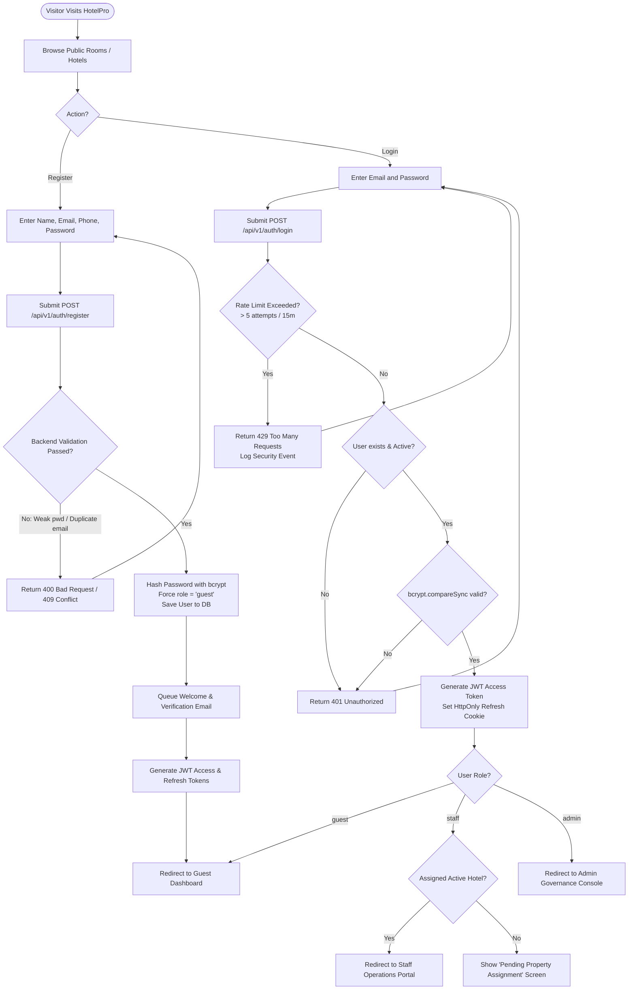
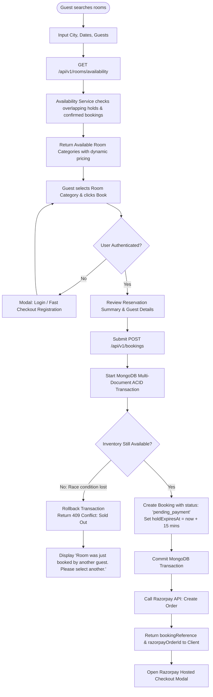
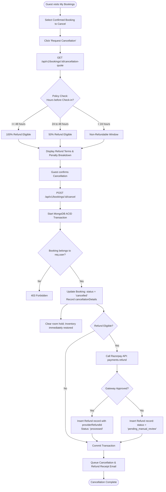
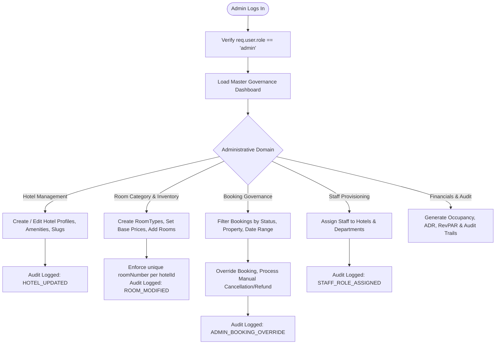
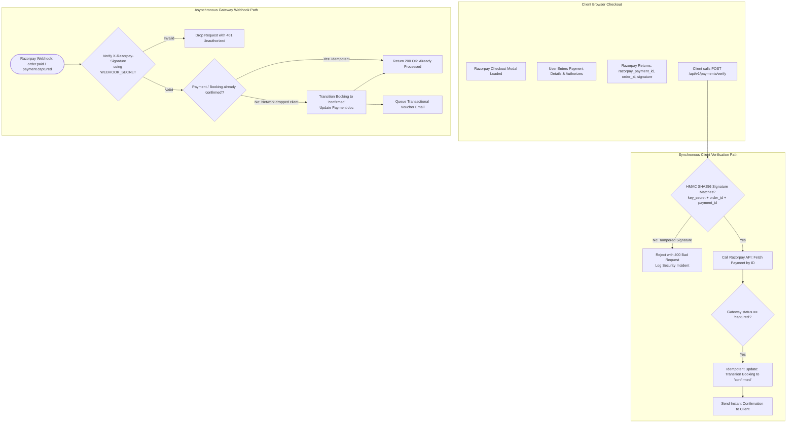
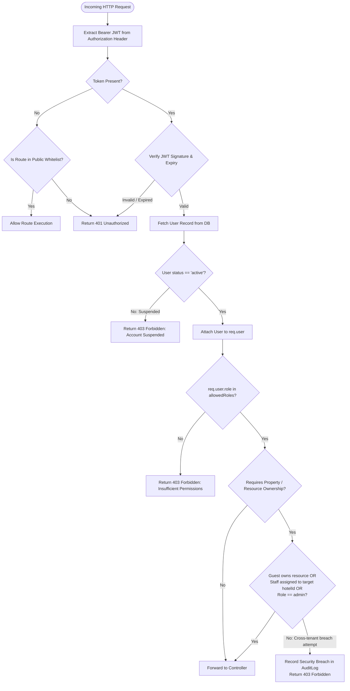

# HotelPro — User Flows & Operational Workflows

## 1. Overview & Architectural Integrity

This document defines the core user journeys and system state progressions for **HotelPro**. Each workflow diagrams the interaction between the User (Guest, Staff, or Admin), the React Frontend, the Express/Node.js Application Tier, the Persistence Tier, and External Services (Razorpay, Nodemailer).

### Critical Vulnerability Rectified
The initial legacy user-flow diagram illustrated a direct transition: `SignUp → Login → Admin`. This allowed unvetted public visitors to gain root administrative access to all hotels, bookings, and users.
In the refined architecture:
- Public sign-ups are strictly restricted to the `guest` role.
- Privileged roles (`staff`, `admin`) can only be provisioned through secure command-line bootstrap scripts or explicitly authorized, audit-logged super-admin delegation.
- All routes, views, and data queries enforce server-side authorization boundaries regardless of client-side routing.

---

## 2. Flow A: Registration, Authentication & Role-Based Routing



### Failure Modes & Recovery
- **Duplicate Registration Email**: Returns `409 Conflict`. Frontend displays an inline warning suggesting password recovery.
- **Credential Brute-Force**: IP and email identifiers are rate-limited via `express-rate-limit`. Exceeding 5 failures locks the endpoint for 15 minutes and logs an entry in `audit_logs`.
- **Session Revocation**: Logging out clears client memory and invalidates refresh token cookies server-side.

---

## 3. Flow B: Room Discovery, Dynamic Pricing & Booking Creation



### Failure Modes & Recovery
- **Double-Booking Prevention**: When two users simultaneously checkout the last room, the MongoDB transaction guarantees that only the first committed transaction succeeds. The second receives a `409 Conflict` gracefully.
- **Hold Expiry**: If checkout is abandoned or unpaid after 15 minutes, the background job releases the hold automatically, restoring inventory.

---

## 4. Flow C: Cancellation & Automated Refund Workflow



---

## 5. Flow D: Staff Front Desk & Housekeeping Operations

```mermaid
flowchart TD
    StaffStart([Staff Member Logs In]) --> StaffAuth[Verify Role in ['staff', 'admin']]
    StaffAuth --> LoadHotel[Load Assigned Hotel Dashboard]
    
    LoadHotel --> OpChoice{Operational Task}

    OpChoice -->|Guest Check-In| LookupReservation[Lookup Booking by Reference or Guest Name]
    LookupReservation --> VerifyCheckInDate{Check-in Date matches Today?}
    VerifyCheckInDate -->|No| EarlyWarning[Warn: Early Check-in or Date Mismatch]
    VerifyCheckInDate -->|Yes| VerifyPaid{Payment Status = Captured?}
    VerifyPaid -->|No| CollectPayment[Prompt Staff: Settle Outstanding Balance]
    CollectPayment --> AssignPhysicalRoom
    VerifyPaid -->|Yes| AssignPhysicalRoom[Select Clean Room from available inventory]
    AssignPhysicalRoom --> ExecuteCheckIn[POST /api/v1/staff/check-in<br/>Update Room: 'occupied'<br/>Update Booking: 'checked_in']
    ExecuteCheckIn --> IssueKeys[Generate Registration Card & Key Allocation]

    OpChoice -->|Guest Check-Out| FindOccupied[Lookup Occupied Room]
    FindOccupied --> SettleIncidentals[Review Service Requests / Incidentals]
    SettleIncidentals --> ProcessCheckOut[POST /api/v1/staff/check-out<br/>Update Booking: 'checked_out'<br/>Update Room: 'maintenance']
    ProcessCheckOut --> AutoDispatchHousekeeping[Auto-create HousekeepingTask: 'turnover', priority: 'high']

    OpChoice -->|Housekeeping| ViewTaskList[View Assigned Cleaning Tasks]
    ViewTaskList --> UpdateTask[Update Task Status: 'in_progress' → 'completed']
    UpdateTask --> InspectorVerify[Inspector verifies: Room status set to 'available']
```

---

## 6. Flow E: Admin Governance & Hotel/Inventory Management



---

## 7. Flow F: Payment Verification & Gateway Webhook Processing



---

## 8. Flow G: Security, RBAC & Context Isolation Enforcement


